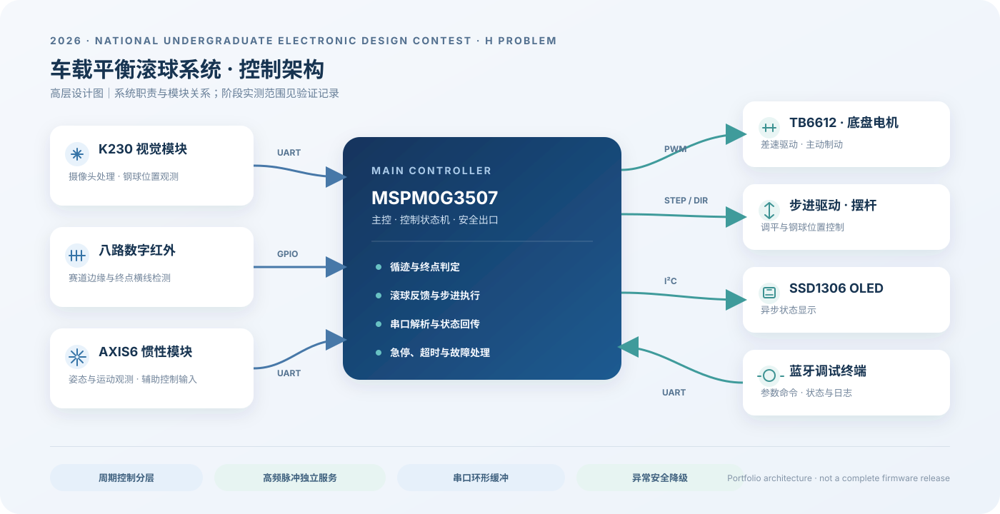

# 2026 全国大学生电子设计竞赛 H 题

## MSPM0 车载平衡滚球系统

**精选作品集版本 · 嵌入式控制与多模块系统集成**

广东赛区省级三等奖 · 团队项目

---

本仓库记录我在 2026 年全国大学生电子设计竞赛 H 题中的软件与系统集成工作。作品围绕循迹底盘、K230 视觉处理板、步进摆杆和车载控制状态机展开。

这是面向作品集的精选展示，不是完整可烧录竞赛工程。系统级说明记录完整项目中的设计与阶段结果；本仓库只公开一个代表性算法模块，不能仅凭本仓库复现或逐行核对所有系统行为。

## 项目概览

| 项目 | 内容 |
|---|---|
| 主控 | TI MSPM0G3507 |
| 运动与感知 | 八路数字红外循迹、K230 钢球视觉、步进摆杆、AXIS6 惯性观测模块 |
| 车载交互 | 蓝牙调试、OLED 状态显示、按键任务入口 |
| 软件重点 | 周期控制、状态机、安全停车、串口解析、模块协同与实机验证 |

## 我的贡献

- 设计 MSPM0 主控的软件模块边界、控制状态和安全退出路径。
- 实现并调试底盘循迹、终点识别/制动、步进摆杆和滚球控制相关软件。
- 联调 K230、AXIS6、蓝牙和 OLED 的主控通信与状态回传，整理实机问题和阶段验证记录。

Codex 用于辅助方案推演、代码检查和资料整理；项目硬件操作、参数选择、功能取舍及实测结论由我确认。

## 系统结构

  

更完整的模块职责、控制路径和降级关系见 [系统架构](docs/architecture.md)。

## 阶段验证

| 功能 | 已记录结果 | 结论边界 |
|---|---|---|
| 数字八路底盘循迹 | 当前赛道连续 5 圈通过，约 16 秒/圈 | 当前赛道与底盘条件下的阶段结果 |
| 增强终点识别与停车 | 无球底盘连续 3 次完成，均小于 20 秒；未观察到漏停或提前误停 | 停车厘米偏差未逐次测量，不能声称达到 2 cm 指标 |
| A 到 B 带球联调 | 5 次人工在 B 点停止，记录时间约 6.63–6.83 秒，球偏移峰值约 20–41 mm | B 点由人工停止；偏移高于题目 10 mm 目标，不能称为达标 |

这些数字来自项目期间的阶段实机记录，不是对本仓库当前代码快照的独立复测；阶段固件与精选源码没有逐文件版本关联。

四项任务状态机另有阶段代码，但组合固件尚未逐项完成实机回归，代码也不包含在本仓库中；测试条件与其他限制见 [验证记录](docs/validation.md)。

## 精选源码

本仓库只保留一个平台无关的八路数字传感器位置与终点图案判定模块，作为控制软件中的代表性代码。它不包含完整应用状态机、硬件引脚配置、整车参数或厂商 SDK，因此不能单独生成竞赛固件。

- [`src/line8digital/line8digital_math.c`](src/line8digital/line8digital_math.c)
- [`src/line8digital/line8digital_math.h`](src/line8digital/line8digital_math.h)

## 仓库边界

为了展示个人负责的软件工作，同时保留团队实现与现场调参的边界，本精选版不发布完整竞赛固件、精确调参表、原始串口日志、模型/数据集、可执行烧录文件、外部队伍资料或个人电脑路径。公开代码没有授予开源复用许可；详见 [`LICENSE`](LICENSE) 与 [`THIRD_PARTY_NOTICES.md`](THIRD_PARTY_NOTICES.md)。

## 文档

- [系统架构与关键设计](docs/architecture.md)
- [阶段验证与未完成项](docs/validation.md)
- [第三方声明](THIRD_PARTY_NOTICES.md)
